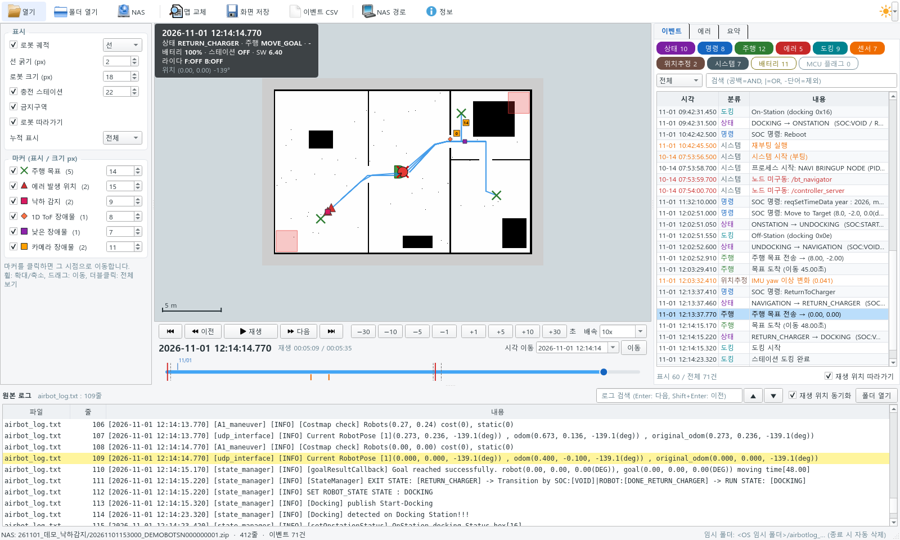

# Airbot Log Analyzer

로봇 로그(AMR_LOG)를 맵 위에서 재생하며 주행 이력·상태 변화·에러를 분석하는 도구입니다.

## 주요 기능
- **압축 로그 바로 열기**: NAS 수집 zip, `AMR_LOG.tar(.gz)`, 폴더, `airbot_log*.txt` (끌어다 놓기 지원)
  - 임시 폴더에 풀고, 다른 로그를 열거나 종료하면 자동 삭제
- **NAS 연결**: 로그 폴더 탐색·검색 후 바로 분석 (읽기 전용: 목록 조회와 로컬 복사만)
- **맵 재생**: 로봇 위치·방향·궤적(선/포즈), 주행 목표, 장애물·낙하·에러 위치 마커, 상태 HUD
- **재생 조작**: 배속(선택/입력), ±1/5/10/30초 이동, 이전/다음 이벤트, 시각 이동
- **이벤트 목록**: 상태 전이·SOC 명령·주행·에러·도킹·센서 등 분류/검색, 클릭 시 해당 시점으로 이동
- **원본 로그 동기화**: 현재 시점 줄 강조, 전체 검색, 더블클릭 이동
- **에러/요약**: 시점별 활성 에러, 발생/해제 이력, 에러 코드별 집계, 부팅·주행·도킹 통계
- **규칙 파일**: `config/rules.yaml` 수정만으로 이벤트·마커 추가
- **라이트/다크 테마**: 툴바 오른쪽 해/달 아이콘

## 빠른 시작
| OS | 실행 |
|---|---|
| Windows | `run.bat` 더블클릭 |
| Linux / WSL | `./run.sh` |

처음 실행할 때 `.venv`를 만들고 필요한 패키지를 설치합니다 (수 분). 자세한 내용은 [설치 및 NAS 연결](docs/SETUP.md).

## 문서
- [설치 및 NAS 연결](docs/SETUP.md)
- [사용 가이드](docs/USER_GUIDE.md)
- [변경 이력](CHANGELOG.md)

## 개발
- 구조: `airbotlog/` (압축·NAS·파싱·모델), `airbotlog/ui/` (PySide6 화면), `config/` (설정·규칙)
- 테스트: `.venv/bin/pip install pytest` 후 `.venv/bin/python -m pytest tests` (데모 로그 자동 생성, UI 테스트 포함)
- 데모 로그: `python scripts/make_demo_data.py <출력 폴더>`
- 문서 캡처: `python scripts/capture_docs.py <로그 압축> [--nas]`
- 릴리스: 버전(`airbotlog/__init__.py`) · `CHANGELOG.md` · 문서 캡처를 함께 갱신, 배포 zip은 `scripts/make_release.sh`
