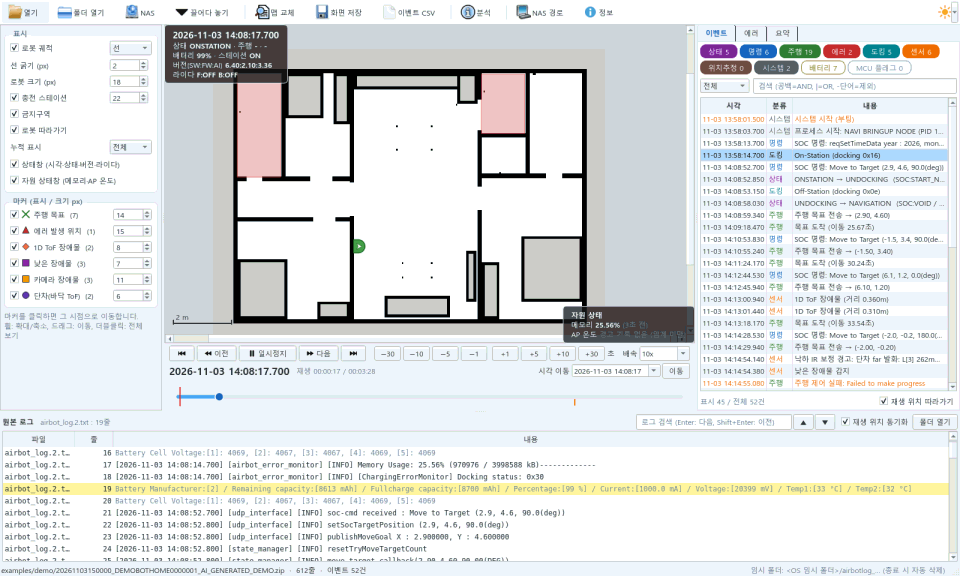
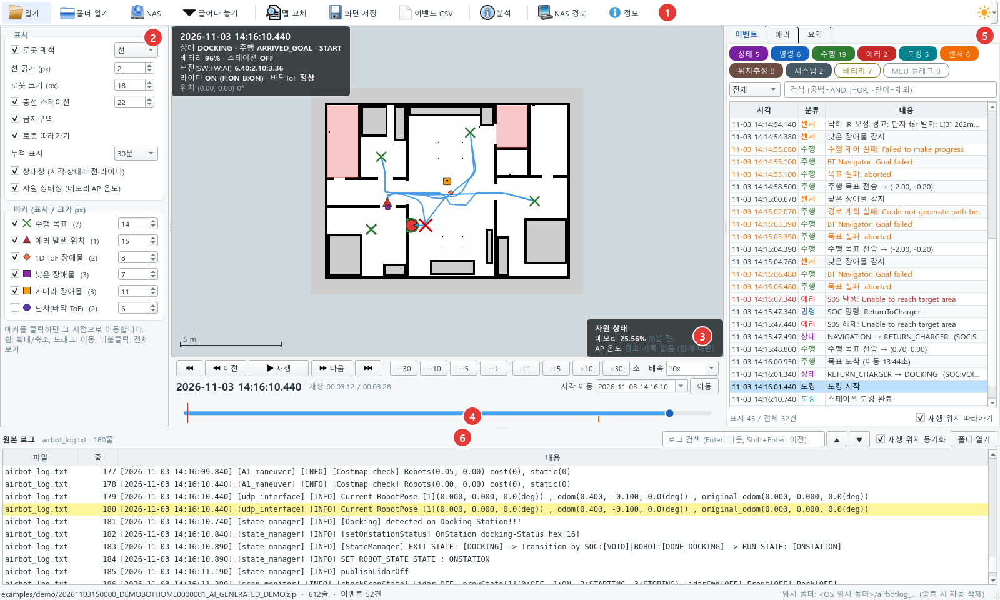
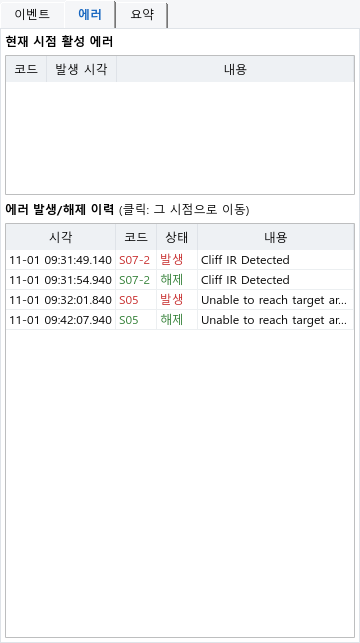
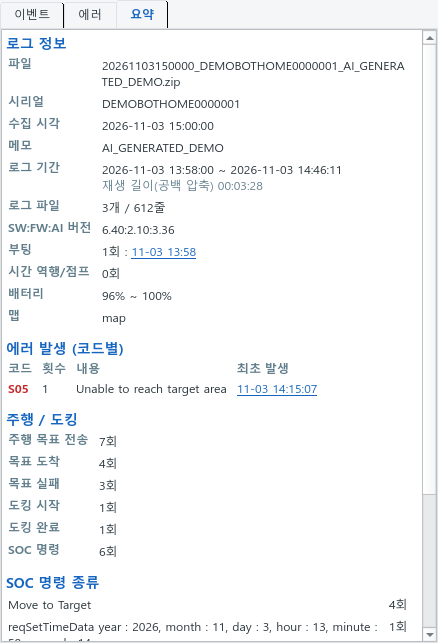
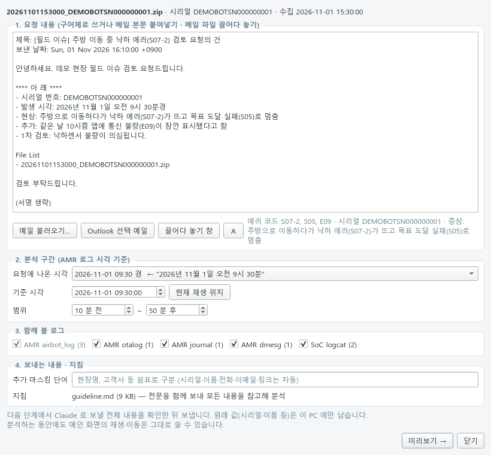
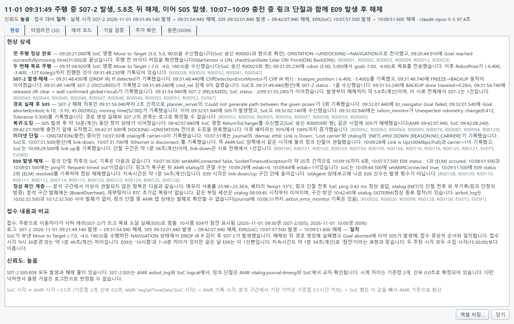

# Airbot Log Analyzer 기능 소개

로봇의 현장 로그(AMR_LOG)를 **맵 위에서 재생**하며 주행·상태·에러를 시간 순서대로 따라가고,
요청 메일과 여러 로그를 묶어 **AI(Claude)로 '현상'까지 정리**하는 분석 도구입니다.

AI로 생성한 데모 로그(32평형 집, [examples/demo](../examples/demo/))를 빠른 배속으로 재생한 화면:
주행 시작 → 카메라·1D ToF 장애물 회피 → 문턱 단차로 도착 실패(S05) → 충전 복귀

## 한눈에 보기
| 기능 | 하는 일 |
|---|---|
| 로그 재생 | 압축 로그를 바로 열어 로봇 위치·궤적·목표·장애물/에러 마커를 맵 위에서 재생 (배속, ±초, 이전/다음 이벤트) |
| 상태창 | 재생 위치 시점의 상태·배터리·SW:FW:AI 버전·라이다, 자원(메모리·AP 온도) |
| 이벤트 · 에러 | 상태 전이·명령·주행·센서·도킹 분류와 검색, 활성 에러·발생/해제 이력, 원본 로그 동기화 |
| NAS 연결 | 현장 로그 폴더 탐색·검색 → 로컬 복사 후 분석 (읽기 전용) |
| AI 현상 분석 | 요청(구어체/메일) + airbot_log·otalog·journal·SoC logcat 통합 타임라인 → Claude → 현상 정리, 엑셀 분석표 |
| 규칙 파일 | `config/rules.yaml` 만 고쳐 이벤트·마커·상태창 항목 추가 |

## 1. 맵 위에서 재생

- zip · tar.gz · 폴더 · 텍스트 로그를 끌어다 놓으면 임시 폴더에 풀어 바로 재생 (닫으면 자동 삭제)
- 회전된 로그 파일을 이어 붙이고, 재부팅 후 RTC 초기값 같은 **시간 역행·점프**는 재생 축을 따로 두어 처리
- 5초 넘는 공백은 압축 재생 → 대기가 긴 로그도 주행 구간 위주로 확인
- 마커·이벤트를 클릭하거나 원본 로그를 더블클릭하면 그 시점으로 이동

## 2. 상태창
| 상태창 | 내용 |
|---|---|
| 기본 (좌상단) | 시각 · 로봇/주행 상태 · 배터리 · 스테이션 · 버전(SW:FW:AI) · 라이다 · 위치 |
| 자원 (우하단) | 메모리(마지막 기록이 몇 분 전인지) · AP 온도(임계 초과 경고 기록 기준) |

- 버전은 SoC 로 보내는 값을 쓰고, airbot_log 에 없으면 otalog 의 OTA 완료 기록으로 그 시각의 버전을 채웁니다.
- 기록 방식이 다른 값(주기 기록, 임계 초과 때만 기록)은 **언제 기록된 값인지** 함께 보여 줍니다.
- 표시 설정에서 각각 켜고 끌 수 있습니다.

## 3. 이벤트 · 에러 · 요약

 

## 4. AI 현상 분석 [분석]

1. 요청 내용 입력: 구어체, 메일 파일·Outlook 메일 끌어다 놓기(.eml .msg .mht .html .txt — 내용으로 형식 판별),
   또는 [Outlook 선택 메일] → 시리얼·에러 코드·시각 자동 추출 (WSL 은 Windows 쪽 '끌어다 놓기 창'으로 받음)
2. 분석 구간과 함께 볼 로그 선택 → 4가지 로그를 AMR 시각으로 정렬
   (SoC 는 시간 동기화 명령으로 구한 시계 차이 보정, dmesg 는 journal 커널 줄로 환산)
3. 미리보기: 시리얼·이름·연락처를 토큰으로 바꾼 **보낼 내용 전체**를 확인
4. Claude Code CLI 로 분석 → 응답 형식·근거 줄 번호 검증 (문제 시 1회 재요청)
5. 결과 창(타임라인 더블클릭 → 메인 화면 이동)과 엑셀 분석표 ([예시](examples/))

## 5. 데모로 바로 해보기
1. 실행: Windows `run.bat`, Linux/WSL `./run.sh` (처음 한 번 패키지 자동 설치)
2. [`examples/demo`](../examples/demo/) 의 zip 을 창에 끌어다 놓고 **재생**

데모 로그는 AI 로 만든 가상 데이터입니다 (실제 로봇·고객 데이터 아님).

## 6. 만든 방식
- Python 3.10+ · PySide6(Qt) · PyYAML · openpyxl, AI 분석은 Claude Code CLI 비대화 모드(JSON 스키마 출력)
- 재생 축: 로그 시각과 별도의 단조 증가 축 → 시간 역행·공백 압축에도 이동·검색·마커가 일관
- 큰 로그: 약 70만 줄 압축 로그를 3~6초에 불러옴. 작업 스레드는 Qt 없이 돌리고 결과는 메인 스레드가 가져감 (Qt 스레드 충돌 방지)
- 에이징 테스트(기능별 20회 반복)로 로그를 다시 열 때의 메모리 누수를 찾아 수정
- 테스트: pytest (파서·분석·화면·한글 입력, 화면 없이 실행)
