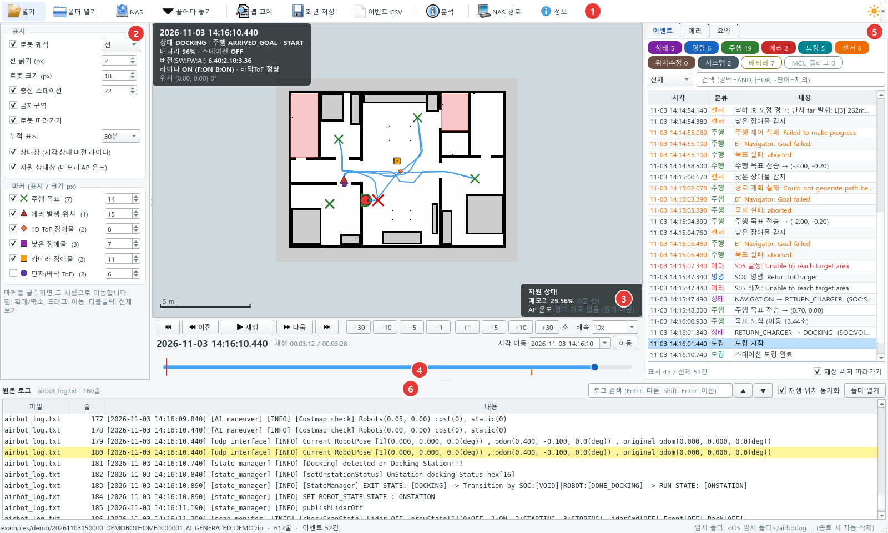
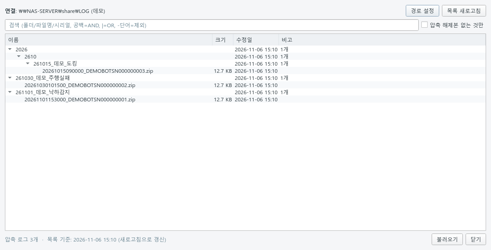
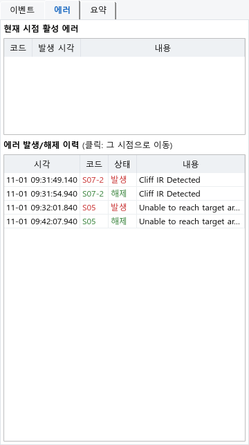
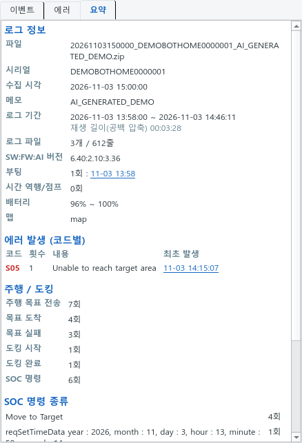
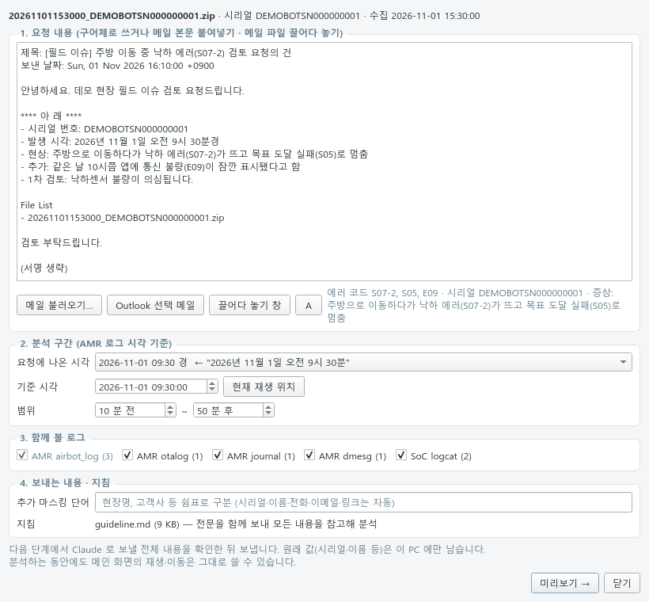
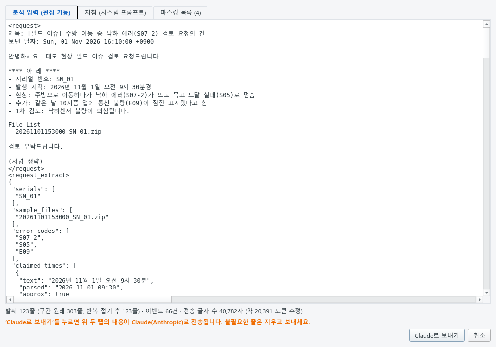
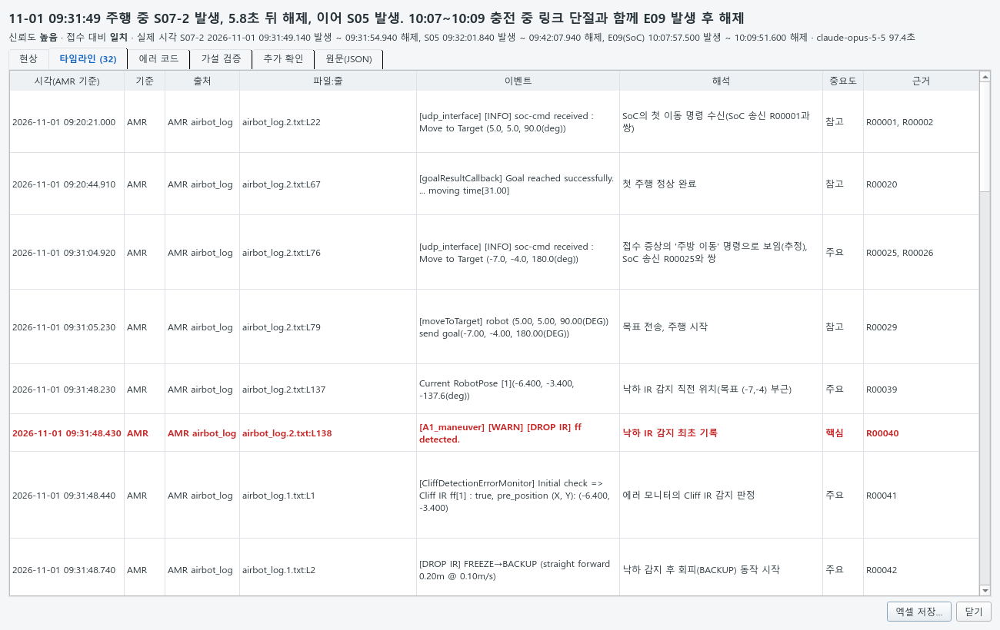

# 사용 가이드

> 기능 한눈에 보기·재생 영상: [기능 소개](FEATURES.md)



| 번호 | 영역 | 설명 |
|---|---|---|
| ① | 툴바 | 열기 · 폴더 열기 · NAS · 맵 교체 · 화면 저장(PNG) · 이벤트 CSV · **분석(AI)** · NAS 경로 · 테마(오른쪽 해/달) |
| ② | 표시 설정 | 궤적(선: 최근 N분 / 포즈: 최근 N개), 로봇·스테이션 크기, 상태창·자원 상태창 켜기/끄기, 누적 표시 범위, 마커별 표시·크기 |
| ③ | 맵 | 로봇(빨강, V자 홈 = 진행 방향)·궤적·주행 목표(점선)·마커, 스테이션(흰 화살표 = station_pose 방향). 좌상단 상태창, 우하단 자원 상태창, 우상단 활성 에러 |
| ④ | 재생 | 재생/정지 · 이전/다음 이벤트 · ±1/5/10/30초 이동 · 배속(선택/입력) · 시각 이동 · 타임라인 |
| ⑤ | 이벤트/에러/요약 | 이벤트 목록, 활성 에러·이력, 로그 요약 |
| ⑥ | 원본 로그 | 현재 시점 줄 강조, 검색, 더블클릭으로 그 시점 이동 |

## 1. 로그 불러오기
- **끌어다 놓기** 또는 **[열기]**: NAS 수집 zip, `AMR_LOG.tar(.gz)`, `airbot_log*.txt`
  - WSL 에서는 앱 창에 바로 끌어다 놓을 수 없어(WSLg 미지원, 마우스가 금지 표시) 툴바 **[끌어다 놓기]** 로 Windows 쪽 작은 창을 띄워 거기에 놓습니다.
- **[폴더 열기]**: 이미 풀린 로그 폴더
- **[NAS]**: 목록에서 더블클릭하면 로컬로 복사해 분석 (검색: 공백=AND)
- **데모**: [`examples/demo`](../examples/demo/) 의 zip — AI 로 생성한 가상 로그(32평형 집 주행 시나리오)로 기능을 바로 확인



> 압축은 임시 폴더에 풀리고, 다른 로그를 열거나 프로그램을 닫으면 자동 삭제됩니다.

## 2. 재생
| 조작 | 키 |
|---|---|
| 재생 / 정지 | Space |
| 이전 / 다음 이벤트 | ← / → |
| 처음 / 끝 | Home / End |
| 원본 로그 검색 / 이벤트 검색 | Ctrl+F / Ctrl+E |

- **±초 버튼**: 실제 로그 시간 기준 이동. 누르고 있으면 계속 이동하고, 재생 중 누르면 일시정지합니다.
- **배속**: 목록에서 고르거나 숫자를 입력하고 Enter.
- 타임라인: 빨강=부팅, 회색 점선=시간 역행/점프(재부팅 후 RTC 초기값 등), 주황=에러, 파랑=날짜
- 5초 넘는 로그 공백은 압축해서 재생합니다 (재생 시간 ≠ 실제 시간). ±초 이동도 긴 공백은 건너뜁니다.
- 마커를 클릭하면 그 시점으로 이동합니다. 맵 더블클릭 = 전체 보기.

### 상태창
재생 위치 시점의 값을 보여줍니다. **표시 설정**에서 각각 켜고 끌 수 있습니다 (설정 저장).

| 상태창 | 내용 |
|---|---|
| 상태창 (좌상단) | 시각 · 로봇/주행 상태 · 배터리 · 스테이션 · **버전(SW:FW:AI)** · 라이다 · 위치 |
| 자원 상태창 (우하단) | **메모리**(10분 주기 기록, 몇 분 전 값인지 표시) · **AP 온도**(임계 초과 경고·해제 때만 기록) |

- 버전: SoC 로 보내는 `SW:FW:AI` 버전. airbot_log 에 없으면(회전으로 잘림 등) otalog 의 OTA 기록으로 그 시각에 적용된 버전(마지막 OTA 완료 버전)을 보여줍니다.
- 라이다: 켜기/끄기 명령 → 켜짐 확인 → `checkScanState` 순으로 추적합니다 (`scan state is …` 줄은 라이다가 꺼져 있는 동안에만 찍힘).
- AP 온도 기록이 없으면 "경고 기록 없음 (임계 미만)"으로 표시합니다. 평상시 온도는 로그에 남지 않습니다.

## 3. 이벤트 · 에러 · 요약
<p> </p>

- **이벤트**: 분류 버튼으로 켜고 끄기, 레벨 필터, 검색(공백=AND, `|`=OR, `-단어`=제외), 클릭 시 이동
- **에러**: 현재 시점의 활성 에러, 발생/해제 이력
- **요약**: 시리얼·기간·SW:FW:AI 버전·부팅 횟수, 에러 코드별 횟수(최초 발생 클릭 시 이동), 주행/도킹 통계

## 4. 분석 (AI 현상 분석)
툴바 **[분석]**: 요청 내용(구어체 또는 메일)과 로그 타임라인을 Claude 에 보내 **'현상'까지** 정리하고 엑셀 분석표를 만듭니다.
원인·대책은 사람이 작성합니다 (엑셀에 빈칸으로 남김). 준비: Claude Code 설치·로그인 ([설치](SETUP.md#5-분석-기능-claude-code)).



1. **요청 내용**: 구어체로 쓰거나 메일 본문을 붙여 넣기. 시리얼·에러 코드·시각을 자동으로 찾습니다.
   - **메일 파일·Outlook 메일 끌어다 놓기**: [분석] 창(또는 메인 창)에 놓거나 **[메일 불러오기]**.
     `.eml` `.msg`(Outlook) `.mht` `.html` `.txt` 를 확장자가 아니라 내용으로 판별해 읽고, 여러 개면 이어 붙입니다.
     Outlook 목록에서 메일을 바로 끌어와도 됩니다. 메인 창에 로그와 메일을 함께 놓으면 로그를 연 뒤 [분석] 창에 메일을 넣습니다.
   - **WSL**: 앱 창에는 끌어다 놓을 수 없어 **[끌어다 놓기 창]** 을 누르면 Windows 화면 가운데 작은 창이 뜹니다. 거기에 놓으세요.
   - **[Outlook 선택 메일]**: Outlook(클래식)에서 지금 보고 있는 메일을 바로 가져옵니다 (Windows·WSL, Outlook 실행 중).
     메일 창이 앞에 있으면 그 메일, 목록이면 선택한 메일입니다.
   - 한글 입력: WSL 에서는 Windows 한글 입력기가 앱에 전달되지 않아 앱 자체 한글 입력(두벌식)을 씁니다.
     **[A/한]** 버튼, 한/영 키 또는 **Shift+Space** 로 전환합니다. (Windows 실행에서는 Windows 입력기를 그대로 사용)
2. **분석 구간**: 요청에 나온 시각(또는 현재 재생 위치)을 기준으로 앞뒤 몇 분. 메일 시각이 틀리는 경우가 있으니 확인하세요.
   메일 머리글의 보낸·받은 날짜는 후보에서 빼고, 로그 기간 밖 후보는 '⚠ 로그 기간 밖'으로 표시합니다.
   구간에 로그가 한 줄도 없으면 보내기 전에 알려 줍니다.
3. **함께 볼 로그**: airbot_log 외에 otalog · journal/dmesg · SoC logcat 을 찾아 시각을 맞춥니다
   (SoC 시각은 `reqSetTimeData` 로 구한 시계 차이만큼 보정, dmesg 는 journal 커널 줄로 환산).
4. **미리보기 → Claude로 보내기**: 보낼 전체 내용을 확인한 뒤 보냅니다. 1~2분 걸립니다.
   분석 창·미리보기 창을 띄운 채로 메인 화면에서 재생·이동할 수 있습니다 (진행 상태는 분석 창 안에 표시).



- 보내는 것: 분석 구간 발췌(반복 줄은 접고 최대 1,500줄)와 이벤트 목록, 요청 내용, 분석 지침 전문(`config/analysis/guideline.md`).
  지침의 로그 형식·판정 규칙·과거 사례를 모두 참고해 분석합니다.
- 시리얼·이름·전화·이메일·링크·압축 이름 메모는 `SN_01` 같은 토큰으로 바꿔 보내고, 원래 값은 이 PC 에만 둡니다.
  현장명 등은 **추가 마스킹 단어**에 적으세요. 불필요한 줄은 미리보기에서 지우고 보낼 수 있습니다.



- 결과: 현상 한 줄·상세(①②…)·타임라인·에러 코드·요청자 가설 검증·추가 확인 필요·신뢰도. 모든 항목에 근거 줄 번호(R·EV)가 붙습니다.
- 타임라인 행을 **더블클릭**하면 메인 화면이 그 시점(원본 로그 줄)으로 이동합니다.
- **[엑셀 저장]**: 기존 분석 결과물 양식의 3개 시트 (예: [docs/examples](examples/))
  - `요약`: 시료·버전·접수 현상·실제 발생, [현상] No/항목/내용, 관련 에러, 검토 의견, 추가 확인 필요, 원인·대책(사람 작성)
  - `타임라인`: No · 시각 · 출처(파일:줄) · 실제 로그(원문) · 설명 — 핵심 행 강조
  - `로그 파일`: 분석 대상 로그와 기간, 시각 기준
- 응답의 근거 id·형식은 앱이 다시 검사하고, 문제가 있으면 한 번 다시 요청합니다.

## 5. 이벤트 규칙 추가
`config/rules.yaml`에 규칙을 추가하면 코드 수정 없이 목록·마커·HUD에 반영됩니다.

```yaml
  - id: my_event            # 고유 ID
    category: system        # 분류 (categories 의 id)
    node: state_manager     # 노드 (선택)
    contains: 'keyword'     # 빠른 필터 (선택)
    regex: 'keyword (?P<v>\d+)'
    text: '내 이벤트 {v}'
    level: warn             # info | warn | error
```

필드 전체 설명은 파일 상단 주석을 참고하세요. 분석용 SoC·otalog·journal 규칙은 `config/analysis/rules.yaml`.
