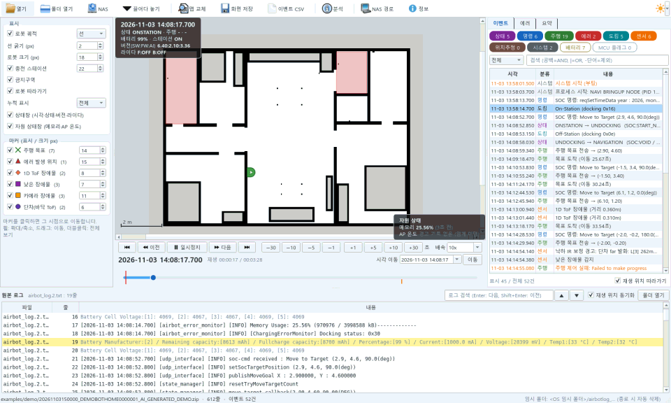

# 데모 로그 (AI 생성)

> **AI로 생성된 demo 용 로그파일입니다.** 실제 로봇·고객·현장 데이터가 아닌 가상 로그입니다.
> 로그 파일마다 첫 줄과 압축 안의 `NOTICE.txt` 에도 같은 안내가 들어 있습니다.

`20261103150000_DEMOBOTHOME0000001_AI_GENERATED_DEMO.zip` — 32평형 집(약 12 × 8.6 m)에서 로봇이 한 번 주행한 로그를 흉내 낸 데이터입니다.
NAS 수집본과 같은 구조(`amr/AMR_LOG.tar.gz` + `soc/logs/logcat`)라서 앱 창에 끌어다 놓거나 **[열기]** 로 바로 재생할 수 있습니다.

| 순서 | 시나리오 | 로그·화면에서 보이는 것 |
|---|---|---|
| 1 | 충전 중 → 주행 시작 | ONSTATION → UNDOCKING → NAVIGATION, 라이다 켜기 |
| 2 | 목적지1 주방 도착 | 목표 도착 |
| 3 | 목적지2 작은방2: 카메라 장애물 감지 → 회피 주행 → 도착 | 카메라 장애물 마커, 경로 재생성 |
| 4 | 목적지3 안방: 1D ToF 장애물 감지 → 회피 주행 → 도착 | 1D ToF 장애물 마커 |
| 5 | 목적지4 작은방1: 문턱 단차 감지 → 재시도 2회 실패 | 단차·낮은 장애물 마커, 목표 실패, **S05** 발생 |
| 6 | 충전 복귀(복귀 경로는 뚫려 있음) → 도킹 | S05 해제, RETURN_CHARGER → DOCKING → ONSTATION |

- 맵: 거실·주방·안방·작은방 2·욕실 2·현관, 금지구역 2곳(욕실1·현관). 충전 스테이션은 거실 서쪽 벽.
- 단차 마커는 기본으로 숨겨져 있습니다. 표시 설정의 **단차(바닥 ToF)** 를 켜면 보입니다.
- 다시 만들기: `python scripts/make_demo_home.py` (같은 내용으로 덮어씀)
